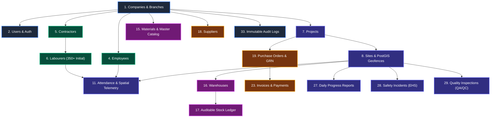
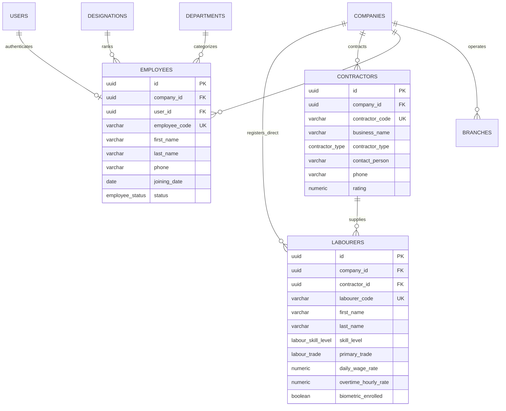
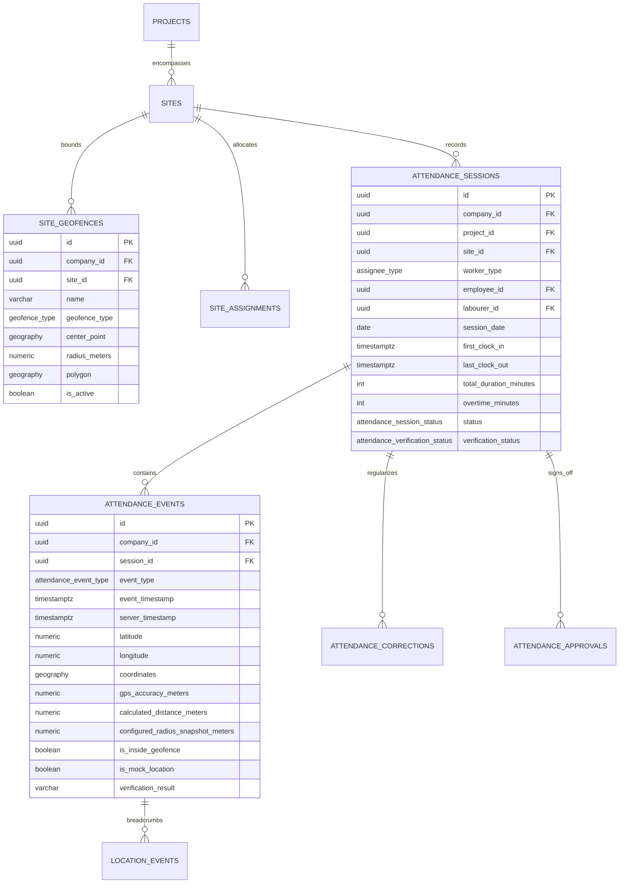
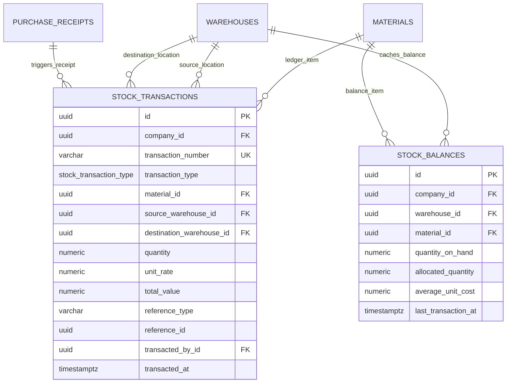

# CONSTRUCT360 — Principal Database Architecture Specification

> **Document Version:** 1.0.0-PROD  
> **Status:** APPROVED FOR ARCHITECTURAL REVIEW (Pre-Implementation Stage)  
> **Target Engine:** PostgreSQL 15+ with PostGIS 3.3+ Extension  
> **Object-Relational Mapping:** Prisma ORM 5+ with Raw PostGIS Extensions  
> **Validation Layer:** Zod 3.24+ Type-Safe Validation  

---

## 1. Executive Architectural Summary

CONSTRUCT360 is an enterprise-grade Construction Operations & ERP platform engineered to orchestrate heavy civil engineering, high-rise building, infrastructure development, and multi-branch contracting companies.

### Foundational Architectural Pillars

```
+----------------------------------------------------------------------------------------------------+
|                                    CONSTRUCT360 DATABASE CORE                                      |
+----------------------------------------------------------------------------------------------------+
|  1. Multi-Tenant Hardening    | Shared-database, shared-schema with PostgreSQL RLS & company_id FK |
|  2. Precision PostGIS Engine   | GEOGRAPHY(Point/Polygon, 4326) for geofences & meter-distance      |
|  3. Auditable Stock Ledger     | Double-entry, append-only immutable ledger; balance is a projection|
|  4. Strict Financial Precision | NUMERIC(15, 2) & NUMERIC(15, 4); Zero IEEE-754 floating-point math  |
|  5. 5-Tier Attendance Telemetry| Sessions, punch events, GPS telemetry, corrections & approvals    |
|  6. Forensic Audit Trails      | System-wide immutable audit logging with JSONB delta captures      |
+----------------------------------------------------------------------------------------------------+
```

### Technology Matrix

| Component | Technology | Architectural Rationale |
| :--- | :--- | :--- |
| **Relational Engine** | PostgreSQL 15+ | Enterprise ACID compliance, declarative table partitioning, GiST spatial indexing, robust Row-Level Security (RLS). |
| **Spatial Engine** | PostGIS 3.3+ | Native geodetic spheroidal math (`GEOGRAPHY(Point/Polygon, 4326)`), exact metric distance calculations (`ST_Distance`, `ST_DWithin`). |
| **Object Relational Mapper** | Prisma ORM 5+ | Type-safe query generation for standard relational models; parameterized `$queryRaw` for PostGIS spatial operators. |
| **Migration Engine** | Raw SQL Migrations | Full control over PostgreSQL extensions, triggers, RLS policies, check constraints, and custom indexes. |
| **Runtime Validation** | Zod 3.25+ | Strict input boundary validation, spatial coordinate limits, and financial decimal enforcement before reaching the database. |

---

## 2. Complete Entity Relationship Diagrams (Mermaid ERD)

### 2.1 High-Level Domain Topology



---

### 2.2 Personnel, Contractors & Labour Ecosystem ERD



---

### 2.3 PostGIS Geofencing, Sites & Attendance Pipeline ERD



---

### 2.4 Materials & Auditable Double-Entry Stock Ledger ERD



---

## 3. Database Domain Dictionary (All 33 Domains)

Below is the exhaustive schema dictionary across all 33 business domains:

### Domain 1: Companies and Branches
* **`companies`**: Root multi-tenant entity.
  * `id` (UUID PK, default `gen_random_uuid()`): Unique tenant identifier.
  * `code` (VARCHAR(50) UNIQUE): Short tenant code (e.g., `APEX-INFR`).
  * `legal_name` (VARCHAR(255) NOT NULL): Formal registered legal corporate entity.
  * `trade_name` (VARCHAR(255)): Brand trading name.
  * `tax_id` (VARCHAR(50)): Corporate tax registration number (GSTIN / VAT / EIN).
  * `currency` (VARCHAR(3) NOT NULL DEFAULT `'INR'`): Base operating currency.
  * `timezone` (VARCHAR(50) NOT NULL DEFAULT `'Asia/Kolkata'`): Operating timezone.
  * `settings` (JSONB NOT NULL DEFAULT `'{}'`): Tenant-specific preferences.
* **`branches`**: Zonal and city offices.
  * `id` (UUID PK), `company_id` (UUID FK), `code` (VARCHAR(50)), `name` (VARCHAR(255)), `city`, `state`, `postal_code`, `is_headquarters` (BOOLEAN).
  * Unique Constraint: `(company_id, code)`.

### Domain 2: Users and Authentication
* **`users`**: Global authentication credentials.
  * `id` (UUID PK), `email` (VARCHAR(255) UNIQUE), `phone_number` (VARCHAR(30) UNIQUE), `password_hash` (VARCHAR(255)), `full_name` (VARCHAR(255)), `avatar_url` (TEXT), `is_active` (BOOLEAN), `mfa_enabled` (BOOLEAN), `mfa_secret` (VARCHAR(255)), `last_login_at` (TIMESTAMPTZ).
* **`user_company_memberships`**: Connects users to authorized tenant companies.
  * `id` (UUID PK), `user_id` (UUID FK), `company_id` (UUID FK), `default_branch_id` (UUID FK), `is_default` (BOOLEAN).
  * Unique Constraint: `(user_id, company_id)`.
* **`user_sessions`**: Refresh tokens and device authorization tracking.
  * `id` (UUID PK), `user_id` (UUID FK), `refresh_token_hash` (VARCHAR(255) UNIQUE), `ip_address`, `user_agent`, `expires_at`, `revoked_at`.

### Domain 3: Roles and Permissions
* **`roles`**: System or tenant-defined authority groups.
  * `id` (UUID PK), `company_id` (UUID FK nullable), `name` (VARCHAR(100)), `slug` (VARCHAR(100)), `is_system_role` (BOOLEAN).
  * Unique Constraint: `(company_id, slug)`.
* **`permissions`**: Granular resource actions.
  * `id` (UUID PK), `category` (VARCHAR(100)), `action` (VARCHAR(100)), `resource` (VARCHAR(100)), `code` (VARCHAR(150) UNIQUE, e.g. `'attendance:approve'`).
* **`role_permissions`**: Many-to-many join between roles and permissions.
  * Primary Key: `(role_id, permission_id)`.
* **`user_roles`**: Tenant and project-scoped role assignment.
  * `id` (UUID PK), `company_id` (UUID FK), `user_id` (UUID FK), `role_id` (UUID FK), `project_id` (UUID FK nullable).
  * Unique Constraint: `(company_id, user_id, role_id, project_id)`.

### Domain 4: Employees
* **`departments`**: Functional units (Civil Engineering, Quality Control, EHS, Accounts).
  * Unique Constraint: `(company_id, code)`.
* **`designations`**: Hierarchical rank (Site Engineer, Project Manager, Foreman).
  * Unique Constraint: `(company_id, title)`.
* **`employees`**: Permanent and contractual salaried staff.
  * `id` (UUID PK), `company_id` (UUID FK), `branch_id` (UUID FK), `user_id` (UUID FK nullable), `department_id` (UUID FK), `designation_id` (UUID FK), `reporting_manager_id` (UUID FK self-reference), `employee_code` (VARCHAR(50)), `first_name`, `last_name`, `email`, `phone`, `joining_date` (DATE), `status` (ENUM: `ACTIVE`, `PROBATION`, `TERMINATED`).
  * Unique Constraint: `(company_id, employee_code)`.

### Domain 5: Contractors
* **`contractors`**: Trade subcontractors, civil vendors, and labor suppliers.
  * `id` (UUID PK), `company_id` (UUID FK), `contractor_code` (VARCHAR(50)), `business_name`, `contractor_type` (ENUM: `GENERAL`, `CIVIL_WORKS`, `REBAR`, `MASONRY`, `LABOUR_SUPPLY`), `contact_person`, `phone`, `tax_id` (GSTIN/PAN), `rating` (NUMERIC(3, 2)).
  * Unique Constraint: `(company_id, contractor_code)`.

### Domain 6: Labourers
* **`labourers`**: Construction workforce (~350 initial headcount, scalable to 50,000+).
  * `id` (UUID PK), `company_id` (UUID FK), `contractor_id` (UUID FK nullable for direct daily wagers), `labourer_code` (VARCHAR(50)), `first_name`, `last_name`, `skill_level` (ENUM: `UNSKILLED`, `SEMI_SKILLED`, `SKILLED`, `HIGHLY_SKILLED`), `primary_trade` (ENUM: `MASON`, `CARPENTER`, `BAR_BENDER`, `ELECTRICIAN`, `PLUMBER`, `SCAFFOLDER`, `GENERAL_HELPER`), `daily_wage_rate` (NUMERIC(10, 2)), `overtime_hourly_rate` (NUMERIC(10, 2)), `biometric_enrolled` (BOOLEAN), `face_embedding` (JSONB).
  * Unique Constraint: `(company_id, labourer_code)`.

### Domain 7: Projects
* **`projects`**: High-level construction contracts.
  * `id` (UUID PK), `company_id` (UUID FK), `branch_id` (UUID FK), `project_code` (VARCHAR(50)), `name`, `client_name`, `contract_value` (NUMERIC(15, 2)), `budget` (NUMERIC(15, 2)), `spent_to_date` (NUMERIC(15, 2)), `start_date`, `planned_end_date`, `actual_end_date`, `status` (ENUM: `PLANNING`, `ACTIVE`, `ON_HOLD`, `COMPLETED`, `ARCHIVED`), `total_area_sqft` (NUMERIC(12, 2)).
  * Check Constraint: `CHECK (planned_end_date >= start_date)`.
  * Unique Constraint: `(company_id, project_code)`.

### Domain 8: Sites
* **`sites`**: Distinct physical plots and workfronts within a project.
  * `id` (UUID PK), `company_id` (UUID FK), `project_id` (UUID FK), `site_code` (VARCHAR(50)), `name`, `site_engineer_id` (UUID FK), `latitude` (NUMERIC(10, 8)), `longitude` (NUMERIC(11, 8)), `location_coordinates` (`GEOGRAPHY(Point, 4326)`), `status` (ENUM: `PREPARATION`, `ACTIVE_CONSTRUCTION`, `FINISHING`, `CLOSED`).
  * Unique Constraint: `(project_id, site_code)`.

### Domain 9: Site Geofences
* **`site_geofences`**: Spatial boundaries for attendance and equipment perimeter control.
  * `id` (UUID PK), `company_id` (UUID FK), `site_id` (UUID FK), `name`, `geofence_type` (ENUM: `CIRCULAR`, `POLYGON`), `center_point` (`GEOGRAPHY(Point, 4326)`), `radius_meters` (NUMERIC(10, 2)), `polygon` (`GEOGRAPHY(Polygon, 4326)`), `is_active` (BOOLEAN).
  * Check Constraint: `CHECK ((geofence_type = 'CIRCULAR' AND radius_meters IS NOT NULL) OR (geofence_type = 'POLYGON' AND polygon IS NOT NULL))`.

### Domain 10: Site Assignments
* **`site_assignments`**: Mapping workers and contractors to authorized sites.
  * `id` (UUID PK), `company_id` (UUID FK), `site_id` (UUID FK), `assignee_type` (ENUM: `EMPLOYEE`, `LABOURER`, `CONTRACTOR`), `employee_id`, `labourer_id`, `contractor_id`, `assigned_from` (DATE), `assigned_to` (DATE), `is_active` (BOOLEAN).
  * Check Constraint: Exactly one assignee foreign key must be populated.

### Domain 11: Attendance (5 Separate Core Entities)
* **`attendance_sessions`**: Shift rollup entity per worker per day.
  * `id` (UUID PK), `company_id` (UUID FK), `project_id` (UUID FK), `site_id` (UUID FK), `shift_id` (UUID FK), `worker_type` (ENUM: `EMPLOYEE`, `LABOURER`), `employee_id` / `labourer_id`, `session_date` (DATE), `first_clock_in`, `last_clock_out`, `total_duration_minutes` (INT), `regular_minutes` (INT), `overtime_minutes` (INT), `status` (ENUM: `PRESENT`, `HALF_DAY`, `ABSENT`, `OVERTIME`, `ON_LEAVE`, `REGULARIZED`), `verification_status` (ENUM: `VERIFIED`, `FLAGGED`, `REJECTED`, `REQUIRES_APPROVAL`), `approval_status` (ENUM: `PENDING`, `APPROVED`, `REJECTED`), `approved_by_id` (UUID FK).
  * Unique Constraint: `(company_id, session_date, worker_type, employee_id, labourer_id)`.
* **`attendance_events`**: Immutable atomic punch records with spatial telemetry preservation.
  * `id` (UUID PK), `company_id` (UUID FK), `session_id` (UUID FK), `project_id`, `site_id`, `geofence_id`, `worker_type`, `employee_id` / `labourer_id`, `event_type` (ENUM: `CLOCK_IN`, `CLOCK_OUT`, `BREAK_START`, `BREAK_END`), `event_timestamp`, `server_timestamp`, `source` (ENUM: `MOBILE_APP`, `KIOSK_FACIAL`, `BIOMETRIC_DEVICE`, `SUPERVISOR_PORTAL`), `verification_method` (ENUM: `GEOFENCE_ONLY`, `FACE_RECOGNITION`, `BIOMETRIC_FINGERPRINT`), `verification_result` (VARCHAR(50)), `latitude`, `longitude`, `coordinates` (`GEOGRAPHY(Point, 4326)`), `gps_accuracy_meters` (NUMERIC(8, 2)), `calculated_distance_meters` (NUMERIC(10, 2)), `configured_radius_snapshot_meters` (NUMERIC(10, 2)), `is_inside_geofence` (BOOLEAN), `is_mock_location` (BOOLEAN), `photo_url`, `device_id`, `device_model`.
  * Trigger: `fn_prevent_immutable_mutation` strictly blocks `UPDATE` or `DELETE`.
* **`location_events`**: Continuous or milestone GPS telemetry pings.
  * `id` (UUID PK), `company_id` (UUID FK), `attendance_event_id` (UUID FK nullable), `recorded_at` (TIMESTAMPTZ), `server_timestamp`, `latitude`, `longitude`, `coordinates` (`GEOGRAPHY(Point, 4326)`), `accuracy_meters`, `speed_mps`, `heading_degrees`, `is_mock_location` (BOOLEAN), `battery_percentage`.
* **`attendance_corrections`**: Disputed attendance regularizations.
  * `id` (UUID PK), `company_id` (UUID FK), `session_id` (UUID FK), `requested_by_user_id` (UUID FK), `correction_type` (ENUM: `MISSING_CLOCK_IN`, `MISSING_CLOCK_OUT`, `WRONG_HOURS`, `GEOFENCE_BYPASS_REQUEST`), `original_clock_in`, `original_clock_out`, `requested_clock_in`, `requested_clock_out`, `reason`, `document_attachment_url`, `status` (ENUM: `PENDING`, `APPROVED`, `REJECTED`), `reviewed_by_user_id` (UUID FK).
* **`attendance_approvals`**: Multi-level sign-off history.
  * `id` (UUID PK), `company_id` (UUID FK), `session_id` (UUID FK), `correction_id` (UUID FK), `approver_user_id` (UUID FK), `approval_tier` (INT: 1: Site Supervisor, 2: PM, 3: HR), `status` (ENUM: `APPROVED`, `REJECTED`), `comments`, `digital_signature_hash`, `action_timestamp`.

### Domain 12: Shifts
* **`shifts`**: Operating shift templates.
  * `code`, `name`, `start_time`, `end_time`, `grace_period_minutes`, `half_day_threshold_minutes`, `full_day_threshold_minutes`, `is_night_shift`.
* **`shift_rosters`**: Daily scheduled shift assignment per worker.
  * Unique Constraint: `(company_id, site_id, roster_date, assignee_type, employee_id, labourer_id)`.

### Domain 13: Leaves
* **`leave_types`**: Leave classification (`annual_days_allowed`, `is_carry_forward`).
* **`leave_balances`**: Tracked employee quotas per financial year.
* **`leave_requests`**: Applied dates, reason, status, approval history.

### Domain 14: Payroll
* **`salary_structures`**: Base salary, HRA, site allowance, PF %, ESI %, professional tax.
* **`payroll_runs`**: Monthly/weekly payroll batch execution (`run_number`, `cycle`, totals).
* **`payslips`**: Itemized gross earnings, daily wage computation, overtime pay, PF/ESI deductions, net payable.

### Domain 15: Materials (Master Catalog)
* **`units_of_measure`**: Standardized units (BAG, MT, CUM, SQM, RMT, NOS).
* **`material_categories`**: Hierarchical category tree (Cement, Rebar, Ready Mix, Finishing).
* **`materials`**: SKU catalog (`item_code`, `standard_rate`, `reorder_level`, `min_stock_level`).

### Domain 16: Warehouses
* **`warehouses`**: Storage facilities (`CENTRAL`, `SITE_STORE`, `LAYDOWN_YARD`, `SCRAP_YARD`, `TRANSIT`).
  * Linked to `company_id`, optional `project_id`, optional `site_id`, `storekeeper_id`.

### Domain 17: Stock Transactions (Double-Entry Ledger)
* **`stock_transactions`**: Append-only immutable ledger.
  * `transaction_number`, `transaction_type` (`RECEIPT_PO`, `ISSUE_PROJECT`, `TRANSFER_OUT`, `TRANSFER_IN`, `RETURN_SUPPLIER`, `RETURN_SITE`, `WASTAGE_DAMAGE`, `ADJUSTMENT_PHYSICAL`), `material_id`, `source_warehouse_id`, `destination_warehouse_id`, `quantity` (`NUMERIC(14, 4)`), `unit_rate` (`NUMERIC(15, 4)`), `total_value` (`NUMERIC(15, 2)`), `batch_number`, `reference_type`, `transacted_by_id`, `transacted_at`.
  * Trigger: `fn_prevent_immutable_mutation` strictly blocks updates and deletions.
* **`stock_balances`**: Derived projection cache.
  * Keyed by `(company_id, warehouse_id, material_id)`. Updated strictly via trigger `trg_apply_stock_transaction_to_balance`.

### Domains 18–20: Procurement (Suppliers, PO, GRN)
* **`suppliers`**: Material and machinery vendors (`supplier_code`, `name`, `tax_id`, `payment_terms_days`).
* **`purchase_orders`** & **`purchase_order_items`**: PO headers and lines (`ordered_quantity`, `unit_price`, `tax_percent`, `total_amount`).
* **`purchase_receipts`** & **`purchase_receipt_items`**: Goods Receipt Notes (GRN), vehicle numbers, accepted vs rejected quantities.

### Domains 21–23: Finance (Expenses, Payments, Invoices)
* **`expense_categories`** & **`expenses`**: Site petty cash and project claims (`amount` `NUMERIC(15, 2)`, receipt URLs, approvals).
* **`invoices`** & **`invoice_items`**: Vendor bills, client progress billing (RA bills), subcontractor billing with retention money.
* **`payments`**: Incoming and outgoing financial vouchers (`payment_mode`, `amount`, UTR / check reference number, reconciliation flag).

### Domains 24–25: Equipment and Maintenance
* **`equipment`**: Cranes, excavators, batching plants, generators (`asset_code`, `ownership`, `current_meter_reading`, `hourly_rate`).
* **`equipment_deployments`**: Assignment to sites, start/end meter readings, assigned operator.
* **`maintenance_schedules`** & **`maintenance_logs`**: Preventive servicing intervals, breakdown repairs, downtime hours, parts replaced.

### Domain 26: Tasks (Work Breakdown Structure - WBS)
* **`tasks`**: WBS task hierarchy (`wbs_code`, `parent_task_id`, `planned_start_date`, `planned_end_date`, `progress_percentage`, `status`).
* **`task_dependencies`**: Predecessor/successor links (Finish-to-Start, Start-to-Start, lag days).

### Domain 27: Daily Progress Reports (DPR)
* **`daily_progress_reports`**: Master daily site report (`dpr_number`, `report_date`, `weather_summary`, `temperature_celsius`, `general_summary`).
* **`dpr_work_items`**: Executed physical work quantities (e.g. 60 m³ concrete poured).
* **`dpr_manpower_counts`**: Headcounts per contractor and trade deployed.
* **`dpr_equipment_usages`**: Operating vs idle hours for machinery.

### Domains 28–29: Safety and Quality (EHS & QA/QC)
* **`safety_incidents`**: EHS reports (`incident_type`, `severity`, root-cause analysis, corrective action plans).
* **`quality_inspection_templates`**: Checklists for concrete pours, rebar inspections, blockwork.
* **`quality_inspections`** & **`quality_defects`**: Inspection results, snag list, NCR defect severity, before/after photos.

### Domains 30–33: Governance, Automation & Compliance
* **`documents`** & **`document_versions`**: Drawing revisions, contracts, CAD files, S3 storage keys, SHA-256 checksums.
* **`notifications`**: In-app, push, email, SMS alerts.
* **`approval_workflows`**, **`approval_steps`**, **`approval_instances`**, **`approval_action_logs`**: Universal multi-tier workflow engine.
* **`audit_logs`**: Immutable security log (`table_name`, `record_id`, `old_data` JSONB, `new_data` JSONB, `ip_address`, `user_agent`, `created_at`).

---

## 4. Tenant Isolation Strategy & Row-Level Security (RLS)

### 4.1 Defense-in-Depth Multi-Tenancy Architecture

CONSTRUCT360 enforces strict tenant isolation using a 3-layer architecture:

```
[Layer 1: Application Layer]
   - Authenticated JWT session extracts verified `company_id`.
   - Never trusts client-supplied query parameters or body payloads for tenant routing.
   - Injects `company_id` into all ORM queries and mutations.

[Layer 2: Schema Referential Layer]
   - All tenant entities possess `company_id UUID NOT NULL REFERENCES companies(id) ON DELETE RESTRICT`.
   - Tenant-scoped composite unique constraints: `UNIQUE (company_id, code)` prevent cross-tenant collisions.

[Layer 3: PostgreSQL Database Engine Layer (RLS)]
   - Every tenant table has `ENABLE ROW LEVEL SECURITY` and `FORCE ROW LEVEL SECURITY`.
   - Evaluated by the PostgreSQL kernel on every SELECT, INSERT, UPDATE, DELETE.
```

### 4.2 RLS Session Configuration & Policy Definition

In every database session or transaction, the application sets the tenant context:

```sql
-- Sets the tenant context for the duration of the transaction
SET LOCAL app.current_company_id = 'c0000001-0000-0000-0000-000000000001';
```

The universal tenant policy applied to all ~45 tenant-owned tables:

```sql
CREATE POLICY tenant_isolation_policy ON <table_name>
FOR ALL
USING (
    company_id = NULLIF(current_setting('app.current_company_id', true), '')::UUID
    OR current_setting('app.bypass_rls', true) = 'on'
)
WITH CHECK (
    company_id = NULLIF(current_setting('app.current_company_id', true), '')::UUID
    OR current_setting('app.bypass_rls', true) = 'on'
);
```

### 4.3 Connection Pooling & PgBouncer Compatibility

When using connection poolers like PgBouncer in **Transaction Pooling Mode**:
- Session variables set via standard `SET` persist across multiple transactions, potentially causing tenant cross-talk.
- **Rule:** CONSTRUCT360 strictly uses `SET LOCAL app.current_company_id = ...` within an explicit transaction block (`BEGIN ... COMMIT`), which automatically clears the variable upon transaction commit or rollback.
- In Prisma, this is executed via an interactive transaction extension or middleware:

```typescript
export async function withTenantContext<T>(
  companyId: string,
  operation: (tx: PrismaClient) => Promise<T>
): Promise<T> {
  return prisma.$transaction(async (tx) => {
    await tx.$executeRaw`SELECT set_tenant_context(${companyId}::uuid);`;
    return operation(tx as unknown as PrismaClient);
  });
}
```

---

## 5. PostGIS Spatial Architecture & Geofencing Guide

### 5.1 Why `GEOGRAPHY(..., 4326)` Over `GEOMETRY`

For construction site geofencing and worker GPS telemetry:
1. **Spheroidal Geodesy:** The Earth is an ellipsoid (WGS 84 / EPSG:4326). Planar Cartesian math (`GEOMETRY`) treats latitude/longitude degrees as flat units on a grid. At 12° North (e.g. Bangalore), 1 degree of longitude is ~108.8 km, while at 45° North it is ~78.8 km.
2. **Native Metric Calculations:** `GEOGRAPHY` calculations (`ST_Distance`, `ST_DWithin`) return exact distances in **meters** without requiring complex projections (e.g. UTM zone transformations).

### 5.2 Circular vs Complex Polygon Geofences

CONSTRUCT360 natively supports both:
* **Circular Geofence:** Ideal for point-centered site gates, laydown yards, and towers. Defined by center point `(latitude, longitude)` and `radius_meters`.
* **Polygon Geofence:** Required for irregular land perimeters, highways, and multi-acre SEZs. Defined by a closed `GEOGRAPHY(Polygon, 4326)` boundary.

### 5.3 Attendance Verification Spatial SQL Query

When an attendance punch is recorded, the database executes the following spatial verification:

```sql
-- Spatial attendance verification against both circular and polygon boundaries
SELECT 
    g.id AS geofence_id,
    g.name AS geofence_name,
    g.geofence_type,
    g.radius_meters,
    -- Distance in meters from worker to geofence center
    ST_Distance(g.center_point, worker_fix) AS distance_to_center_meters,
    CASE 
        WHEN g.geofence_type = 'CIRCULAR' THEN 
            ST_DWithin(g.center_point, worker_fix, g.radius_meters)
        WHEN g.geofence_type = 'POLYGON' THEN 
            ST_Covers(g.polygon::geometry, worker_fix::geometry)
        ELSE false
    END AS is_inside_geofence
FROM site_geofences g,
LATERAL (
    SELECT ST_SetSRID(ST_MakePoint(:worker_longitude, :worker_latitude), 4326)::geography AS worker_fix
) pt
WHERE g.site_id = :site_id
  AND g.is_active = true;
```

### 5.4 Spatial GiST Indexing

Spatial queries utilize Generalized Search Tree (GiST) indexes:
```sql
CREATE INDEX idx_site_geofences_center_gist ON site_geofences USING GIST (center_point);
CREATE INDEX idx_site_geofences_polygon_gist ON site_geofences USING GIST (polygon);
CREATE INDEX idx_attendance_events_coords_gist ON attendance_events USING GIST (coordinates);
CREATE INDEX idx_location_events_coords_gist ON location_events USING GIST (coordinates);
```

---

## 6. Auditable Stock Ledger & Double-Entry Mechanics

### 6.1 The Non-Negotiable Inventory Rule
> **Under no circumstances is inventory balance stored solely as a manually editable quantity.**
> Direct `UPDATE warehouse_items SET quantity = 450` statements are strictly forbidden. Stock balance is solely an auditable mathematical projection of all past ledger movements.

### 6.2 Transaction Classification

Every stock movement must be recorded in `stock_transactions` with an immutable direction:

| Transaction Type | Source WH | Destination WH | Description |
| :--- | :---: | :---: | :--- |
| `RECEIPT_PO` | `NULL` | Required | Material inward from vendor against verified GRN. |
| `ISSUE_PROJECT` | Required | `NULL` | Material issued to workfront for construction consumption. |
| `TRANSFER_OUT` | Required | Required | Dispatched from central store to site store. |
| `TRANSFER_IN` | Required | Required | Acknowledged receipt at destination store. |
| `RETURN_SUPPLIER` | Required | `NULL` | Rejection or excess return back to vendor. |
| `RETURN_SITE` | `NULL` | Required | Unused material returned from workfront to warehouse. |
| `WASTAGE_DAMAGE` | Required | `NULL` | Spoilage, rebar off-cut scrap, or damaged bags write-off. |
| `ADJUSTMENT_PHYSICAL` | Either | Either | Cycle count variance after physical stock audit. |

### 6.3 Materialized Balance Projection & Ledger Immutability

1. **Immutable Trigger:** Any attempt to update or delete rows in `stock_transactions` throws an exception:
   ```sql
   CREATE TRIGGER trg_stock_tx_immutable 
   BEFORE UPDATE OR DELETE ON stock_transactions
   FOR EACH ROW EXECUTE FUNCTION fn_prevent_immutable_mutation();
   ```
2. **Automated Balance Synchronization:** The trigger `trg_apply_stock_transaction_to_balance` updates `stock_balances.quantity_on_hand` and recalculates the weighted average unit cost atomically within the same transaction.
3. **Reversal Pattern:** Errors are resolved exclusively by posting an offsetting reversing entry (`ADJUSTMENT_PHYSICAL`), maintaining a permanent audit trail.

---

## 7. Financial Precision & Decimal Architecture

### 7.1 Ban on Floating-Point Math
Binary floating-point types (`FLOAT`, `DOUBLE PRECISION`, `REAL`) cannot accurately represent base-10 decimals due to IEEE-754 representation limits (e.g. `0.1 + 0.2 = 0.30000000000000004`). In a construction enterprise managing billions in billings, cumulative rounding errors cause financial audits to fail.

### 7.2 Precision Specification Standards

| Financial Domain | PostgreSQL Type | Example Use Case |
| :--- | :--- | :--- |
| **Monetary Amounts** | `NUMERIC(15, 2)` | Invoices, contract values, net payroll, payments up to ₹999 Trillion (or 999 Billion USD). |
| **Unit Rates & Prices** | `NUMERIC(15, 4)` | Unit price per bag, steel price per kg, exchange conversion rates. |
| **Tax & Percentages** | `NUMERIC(5, 2)` | GST / VAT percentages, retention money rates (e.g. 18.00%, 5.00%). |
| **Physical Quantities** | `NUMERIC(14, 4)` | Metric tonnes of rebar, cubic meters of ready-mix concrete, fuel liters. |

---

## 8. Index Strategy & High-Volume Performance Optimization

### 8.1 Index Strategy Breakdown

```
+----------------------------------------------------------------------------------------------------+
|                                    INDEXING BLUEPRINT BY DOMAIN                                     |
+----------------------------------------------------------------------------------------------------+
| 1. Multi-Tenant Prefix B-Trees   | (company_id, record_id), (company_id, code), (company_id, date) |
| 2. Spatial PostGIS GiST Indexes  | USING GIST (center_point), USING GIST (polygon), USING GIST (coords)|
| 3. Append-Only BRIN Indexes      | USING BRIN (recorded_at) on location_events & audit_logs           |
| 4. Partial Performance Indexes   | WHERE is_active = true, WHERE status = 'PENDING'                 |
+----------------------------------------------------------------------------------------------------+
```

### 8.2 High-Volume Time-Series Partitioning

With 350+ workers emitting continuous GPS breadcrumbs and punch events, `location_events` and `audit_logs` will grow rapidly.
* **Monthly Range Partitioning:** Partition `location_events` and `audit_logs` by `recorded_at` / `created_at`:
  ```sql
  CREATE TABLE location_events (
      id UUID DEFAULT gen_random_uuid(),
      company_id UUID NOT NULL,
      recorded_at TIMESTAMPTZ NOT NULL,
      ...
  ) PARTITION BY RANGE (recorded_at);

  CREATE TABLE location_events_y2026m11 PARTITION OF location_events
      FOR VALUES FROM ('2026-11-01 00:00:00+00') TO ('2026-12-01 00:00:00+00');
  ```
* **BRIN Indexing:** Block Range Indexes on chronological timestamp columns provide 95% space reduction compared to standard B-Trees for append-only tables.

---

## 9. Prisma ORM Compatibility & Raw Query Patterns

### 9.1 Where Prisma Schema Maps Directly
Prisma natively models:
- All 33 domain entities, enums, composite unique constraints, relations, and `@map` attributes.
- UUID primary keys via `@default(dbgenerated("gen_random_uuid()"))`.
- High-precision monetary fields via `@db.Decimal(15, 2)` and `@db.Decimal(15, 4)`.

### 9.2 Where Custom SQL & `$queryRaw` Are Required

Because Prisma does not natively support PostGIS spatial types or spatial operators in type-safe client methods:
1. **Spatial Column Declaration:** In `schema.prisma`, PostGIS columns are defined as `Unsupported`:
   ```prisma
   locationCoordinates Unsupported("geography(Point, 4326)")? @map("location_coordinates")
   centerPoint         Unsupported("geography(Point, 4326)")? @map("center_point")
   polygon             Unsupported("geography(Polygon, 4326)")? @map("polygon")
   coordinates         Unsupported("geography(Point, 4326)")? @map("coordinates")
   ```
2. **Spatial Verification via `$queryRaw`:**
   ```typescript
   export async function verifyWorkerGeofence(
     companyId: string,
     siteId: string,
     latitude: number,
     longitude: number
   ) {
     return await prisma.$queryRaw<Array<{
       geofence_id: string;
       name: string;
       distance_meters: number;
       is_inside: boolean;
     }>>`
       SELECT 
         id AS geofence_id,
         name,
         ST_Distance(center_point, ST_SetSRID(ST_MakePoint(${longitude}, ${latitude}), 4326)::geography) AS distance_meters,
         CASE 
           WHEN geofence_type = 'CIRCULAR' THEN 
             ST_DWithin(center_point, ST_SetSRID(ST_MakePoint(${longitude}, ${latitude}), 4326)::geography, radius_meters)
           WHEN geofence_type = 'POLYGON' THEN 
             ST_Covers(polygon::geometry, ST_SetSRID(ST_MakePoint(${longitude}, ${latitude}), 4326)::geometry)
           ELSE false
         END AS is_inside
       FROM site_geofences
       WHERE company_id = ${companyId}::uuid
         AND site_id = ${siteId}::uuid
         AND is_active = true;
     `;
   }
   ```

---

## 10. Database Migration & Operational Runbook

### 10.1 Running Migrations
To initialize the complete database with PostGIS extensions, DDL, triggers, and RLS policies:
```bash
# 1. Ensure DATABASE_URL is set in .env
# 2. Run initial SQL migration
npx prisma migrate dev --name construct360_core_schema
```

### 10.2 Seeding Development Environment
To populate the database with the 2 companies, 350+ workers, PostGIS geofences, and initial inventory ledger:
```bash
# Direct psql execution:
psql -U postgres -d construct360 -f prisma/seed.sql

# Or via Prisma seed runner:
npx prisma db seed
```

---

> **Review Notice:** Per engineering governance directives, feature development must not proceed until this architectural design has been formally reviewed and approved by the lead database architect.
